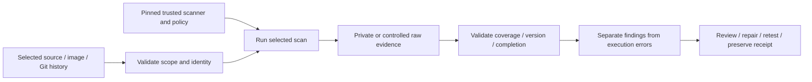

# Checkov Infrastructure Security for Azure

**Find risky infrastructure settings before applying them, and keep every unresolved control visible.**

[Business problem](#the-business-problem) · [Strengths](#where-checkov-is-strong) · [Proof](#proof-it-works) · [Commands](docs/COMMANDS.md)


## The Business Problem

An Azure platform had hundreds of Terraform resources with network, retention, logging, key-lifecycle and availability controls. A failed rule did not always mean an exploitable vulnerability, and a report-only baseline could be mistaken for release approval.

## The Solution

Use pinned Checkov and hash-locked dependencies, stage only tracked Terraform with content hashes, avoid cloud credentials/external module downloads, validate report completeness, and maintain a finding-by-finding triage register. Keep advisory findings distinct from fatal execution/coverage failures.

**Business outcome:** The recorded full-source baseline evaluated 508 resources over 228 inputs: 211 checks passed, 106 failed, with no skips or parse errors. Each remaining occurrence retained its next-evidence requirement rather than being silently suppressed.

## Where Checkov Is Strong

| Strength | Practical value |
| --- | --- |
| **Early infrastructure feedback** | Inspect Terraform definitions before deployment to catch insecure configuration choices while they are still reviewable source changes. |
| **Broad built-in control library** | Rule IDs and resource-level evidence organize checks across storage, networking, logging, identity and availability; custom policies can complement built-in controls. |
| **Actionable triage** | Repeatable resource/file identities, counts and next-evidence tracking support focused remediation without confusing a static finding with live compromise. |

These strengths describe what this tool contributes to the platform's layered checks. It complements the other scanners; it is not a complete application-security assessment. [Strengths, limits and tradeoffs](docs/STRENGTHS-AND-TRADEOFFS.md).

## Architecture



The exact target and output protections differ by scanner. Checkov 3.3.26 is the selected source pin, not a claim that it is the latest release. [Actual source map](docs/SOURCE-MAP.md).

## What Was Built

| Component | Purpose | Implementation |
| --- | --- | --- |
| Actual scanner wrapper | Preserve the real target/trust/output boundary | [Source](scripts/security_checkov.py) |
| Original regression tests | Reject incomplete/malformed evidence and unsafe scope assumptions | [Tests](scripts/) |
| Pinned scanner configuration | Make selected tooling and policy explicit | [Configuration](security/) |
| Actual integration reference | Explain the production CI design without activating it here | [Inert workflow](reference/workflows/security-checkov-baseline.yml.example) |
| Platform findings | Preserve dated fixes and remaining work | [Recorded findings](data/platform-findings.json) |
| Offline example/viewer | Exercise actual parsing/decision code with fictional inputs | [Example](scripts/demo.py) |

## Proof It Works

### 1. Test the actual boundary code

```bash
python -B -m unittest discover -s scripts -p 'test_*.py' -v
python -B scripts/demo.py
```

**Look for:** 10 original tests. The fixture demonstration is labeled and does not pretend to be a current full-platform scan. [Dated validation](docs/VALIDATION.md) records exact executed/skipped cases.

### 2. Inspect genuine scanner evidence separately

A fresh network-isolated scan of two public storage fixtures produced 14 passed and 16 failed checks, with no skips or parse errors. Specific rules changed from Failed to Passed after the narrow fixture changes; unresolved controls stayed visible. No Terraform was applied.


Local scans cover only this public reference. Dated platform reports are retained as history; local fixture output does not replace or clear the full platform finding register. No cloud credentials, resource changes or provider credential verification are needed.

### 3. Follow findings through to a defensible decision

Keep the target, version, database/policy context and completion evidence. Review the actual finding, apply a compatible fix where justified, repeat the relevant checks and preserve unresolved items. A scanner timeout, malformed report or missing inventory cannot become a successful scan with zero findings.

### Triage without hiding failures

The [106-occurrence register](data/platform-open-findings.csv) preserves the source resource, rule ID, category, disposition and next evidence. Network controls, logging/retention, key lifecycle and availability/cost remain distinct categories. A source-level graph match is not deployed proof. Paid tiers and additional private endpoints were not activated for scanner score improvements.

The local fixture narrows two storage settings: Shared Key and nested anonymous access. Some related checks improve, but other failures remain. A passing related rule is not a claim that a different feature, such as a SAS policy, was independently deployed.


## Run the Local Viewer

```bash
python -B scripts/preview.py --port 8138
```

Open [the local reference](http://127.0.0.1:8138). It shows strengths, actual parser behavior on fictional input and dated platform evidence. It performs no scan, cloud request or sign-in. Ctrl+C stops it. Screenshots are local captures, not a hosted security dashboard.

## Limitations and Tradeoffs

| Boundary | What it means |
| --- | --- |
| Static context is incomplete | External/omitted modules, variable resolution and modern alternative controls can require further evidence. |
| Finding is not exploitability | A failed rule may represent cost/availability policy or a missing static graph relationship, not proven compromise. |
| Advisory is not approval | This actual wrapper uses soft-fail for findings; execution, version, parse and coverage errors still fail. It is not a release security gate. |

The reference workflow is manual-only. Actual platform integration examples are inert files outside .github/workflows. No hosted CI run or deployment was performed to create this project. Do not execute candidate package scripts or expose raw secret candidates while adding security checks.

## Project Guides

| Guide | Purpose |
| --- | --- |
| [Strengths and tradeoffs](docs/STRENGTHS-AND-TRADEOFFS.md) | Why this scanner, where it helps and where it stops |
| [Process and integration](docs/PROCESS.md) | Scope, trust, completion and CI decisions |
| [Findings and fixes](docs/FINDINGS-AND-FIXES.md) | Recorded results versus local examples |
| [Commands](docs/COMMANDS.md) | Reproducible local checks and scanner invocation |
| [Operations](docs/OPERATIONS.md) | Failure handling, privacy and triage |
| [Scaling](docs/SCALING.md) | Scope selection, caches, budgets and access |
| [Source map](docs/SOURCE-MAP.md) | Actual source and explicit adaptations |
| [Validation](docs/VALIDATION.md) | Observed local outcomes and limits |

Related projects: [Trivy](https://github.com/truthofsource/trivy-vulnerability-management), [TruffleHog](https://github.com/truthofsource/trufflehog-secret-detection), [Checkov](https://github.com/truthofsource/checkov-azure-infrastructure-security), and [delivery/rollback](https://github.com/truthofsource/secure-container-delivery-and-rollback).
