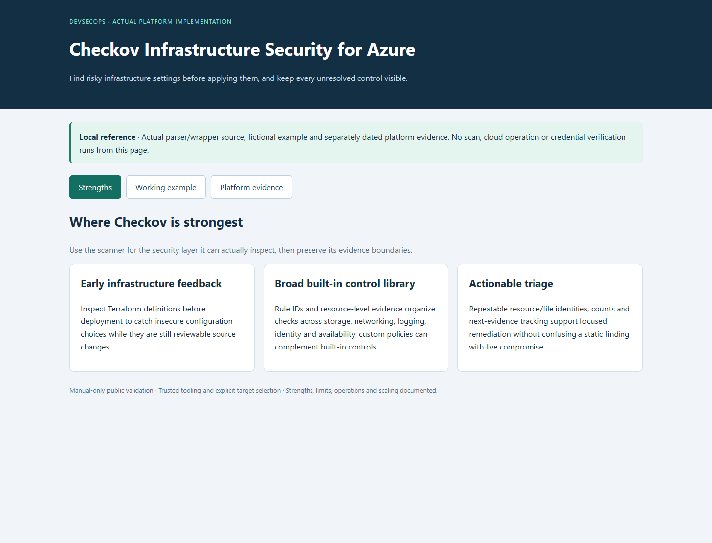
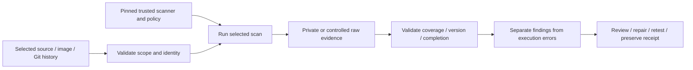
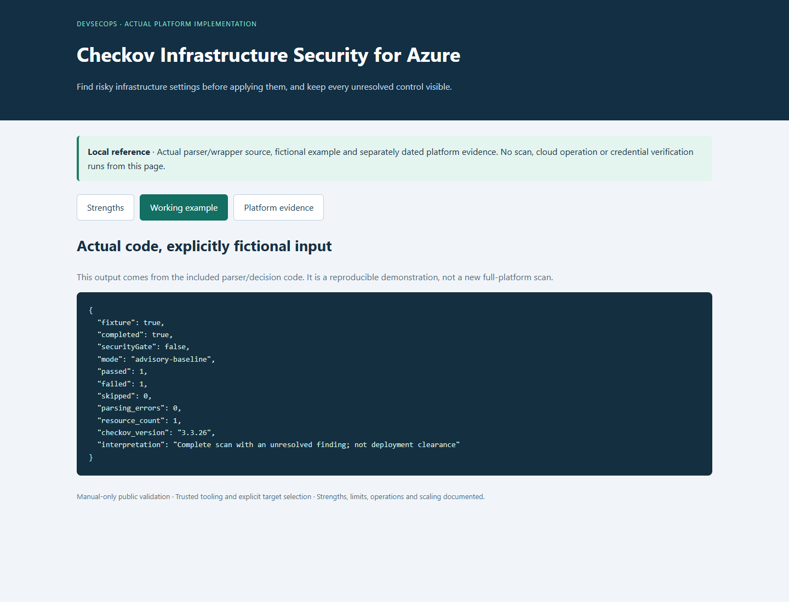

# Checkov Infrastructure Security for Azure

> This project is now part of **[Layered Security Testing for an Azure Platform](https://github.com/truthofsource/azure-devsecops-security-scanning)**, which combines Trivy, Checkov, TruffleHog and OWASP ZAP. This repository remains available for existing links and its original evidence.

**Find risky cloud settings before applying them, and track what still needs attention.**

[Business problem](#the-business-problem) · [Strengths](#where-checkov-is-strong) · [Proof](#proof-it-works) · [Commands](docs/COMMANDS.md) · [Step by step](#step-by-step)



## The Business Problem

The Azure platform has many settings for storage, networking, logging, keys and service reliability. Reviewing them manually is difficult. A failed automated rule also needs context: it may indicate a security issue, a missing requirement or a more expensive design choice.

## The Solution

Use Checkov to examine the Terraform files that describe the cloud resources. Check that the scan completed properly, keep each failed rule visible, and record what evidence or decision is needed next. Do not treat a completed report as permission to release.

**Business outcome:** The recorded platform scan checked 508 resources across 228 inputs: 211 checks passed and 106 failed, with no skipped checks or reading errors. Remaining findings kept their follow-up requirements.

## Tools Used and What They Do

| Tool or service | What it does | Where it fits |
| --- | --- | --- |
| Checkov | Evaluate infrastructure source against defined configuration checks. | Actual IaC scanner; findings are not a live Azure resource inventory. |
| Terraform | Describe the infrastructure and resolve its intended configuration. | Scanned source; actual plan, service state and functionality need separate evidence. |
| Azure CLI | Inspect the exact service configuration when a finding needs context. | Operating utility, not an automatic remediation step. |
| Python and GitHub Actions | Exercise report and policy decisions using fictional inputs. | Public validation is local/manual-only; it does not apply a Terraform fix. |

This retained tool project remains linked from the combined security-scanning portfolio entry. Historical scanner results keep their original target, date and coverage limits.

## Step by Step

A short walkthrough of the process, with technical instructions and evidence limits in the sections below.

1. **Select the cloud setup files (Terraform)** — Choose the infrastructure instructions that need review. Record the selected source and scanner version.

2. **Check the settings (Checkov)** — Checkov compares supported settings with its security rules. Its output identifies passed checks, failed checks and any processing problems.

3. **Review each finding** — Decide what a failed rule means for the actual design. Some changes need further evidence, a business decision or cost approval.

4. **Keep the outcome visible** — Preserve unresolved findings and confirm that the scan covered the intended files. This project uses the report for review rather than treating completion as release approval.

## Where Checkov Is Strong

| Strength | Practical value |
| --- | --- |
| **Early infrastructure feedback** | Check the cloud setup before deployment, while risky settings can still be changed and reviewed in code. |
| **Broad built-in control library** | Use built-in rules to check storage, networks, logs, access and reliability. Add custom rules when the organization needs more specific checks. |
| **Actionable review and prioritization** | Tie each finding to a resource and file, assign follow-up work and record what evidence is needed. A failed rule alone does not prove a system was attacked. |

This tool covers one part of security. The other scanners check different areas, so the results need to be considered together. [Strengths, limits and tradeoffs](docs/STRENGTHS-AND-TRADEOFFS.md).

## Architecture



Each scanner checks a different kind of information and needs suitable protection for its reports. Checkov 3.3.26 is the selected source pin, not a claim that it is the latest release. [Actual source map](docs/SOURCE-MAP.md).

## What Was Built

| Component | Purpose | Implementation |
| --- | --- | --- |
| Scan script | Check the intended files with trusted tools and protect the report | [Source](scripts/security_checkov.py) |
| Existing behavior tests | Reject missing or unreadable reports and checks of the wrong files | [Tests](scripts/) |
| Fixed scanner version and settings | Record the tool version and the rules used | [Configuration](security/) |
| Real pipeline example | Show how the real pipeline runs checks, without running it here | [Inert workflow](reference/workflows/security-checkov-baseline.yml.example) |
| Platform findings | Preserve dated fixes and remaining work | [Recorded findings](data/platform-findings.json) |
| Offline example/viewer | Exercise actual parsing/decision code with fictional inputs | [Example](scripts/demo.py) |

## Proof It Works

### 1. Test the actual boundary code

```bash
python -B -m unittest discover -s scripts -p 'test_*.py' -v
python -B scripts/demo.py
```

**Look for:** 10 original tests. The demonstration using test data is labeled and does not pretend to be a current full-platform scan. [Dated validation](docs/VALIDATION.md) records exact executed/skipped cases.

### 2. Inspect genuine scanner evidence separately

A fresh network-isolated scan of two public storage fixtures produced 14 passed and 16 failed checks, with no skips or parse errors. Specific rules changed from Failed to Passed after the narrow fixture changes; unresolved controls stayed visible. No Terraform was applied.



Local scans cover only this public reference. Dated platform reports are retained as history; local test-example output does not replace or clear the full platform finding register. No cloud credentials, resource changes or provider credential verification are needed.

### 3. Follow findings through to a defensible decision

Keep the target, version, database/policy context and completion evidence. Review the actual finding, apply a compatible fix where justified, repeat the relevant checks and preserve unresolved items. A scanner timeout, incorrectly structured report or missing inventory cannot become a successful scan with zero findings.

### Triage without hiding failures

The [106-occurrence register](data/platform-open-findings.csv) preserves the source resource, rule ID, category, disposition and next evidence. Network controls, logging/retention, key lifecycle and availability/cost remain distinct categories. A source-level graph match is not deployed proof. Paid tiers and additional private endpoints were not activated for scanner score improvements.

The local fixture narrows two storage settings: Shared Key and nested anonymous access. Some related checks improve, but other failures remain. A passing related rule is not a claim that a different feature, such as a SAS policy, was independently deployed.


## Run the Local Viewer

```bash
python -B scripts/preview.py --port 8138
```

Open [the local reference](http://127.0.0.1:8138). It shows strengths, actual parser behavior on fictional input and dated platform evidence. It performs no scan, cloud request or sign-in. Ctrl+C stops it. Screenshots are local captures, not a hosted security dashboard.

## Limitations and Tradeoffs

| Boundary | What it means |
| --- | --- |
| Static context is incomplete | Missing modules, values supplied elsewhere or different ways of meeting a rule may need additional checks. |
| Finding is not exploitability | A failed rule may concern cost, reliability or information the scanner cannot see. It is not proof that a system was compromised. |
| Advisory is not approval | This actual wrapper uses soft-fail for findings; execution, version, parse and coverage errors still fail. It is not a release security gate. |

The reference workflow is manual-only. Actual platform integration examples are inert files outside .github/workflows. No hosted CI run or deployment was performed to create this project. Do not execute candidate package scripts or expose raw secret candidates while adding security checks.

## Troubleshooting Lessons

A narrow configuration operation could still introduce an unintended runtime setting. Plan review had to be followed by exact service readback and a complete reconciliation check. [Read the incident, evidence and verification](docs/LESSONS-LEARNED.md).

## Project Guides

| Guide | Purpose |
| --- | --- |
| [Strengths and tradeoffs](docs/STRENGTHS-AND-TRADEOFFS.md) | Why this scanner, where it helps and where it stops |
| [Process and integration](docs/PROCESS.md) | Scope, trust, completion and CI decisions |
| [Findings and fixes](docs/FINDINGS-AND-FIXES.md) | Recorded results versus local examples |
| [Commands](docs/COMMANDS.md) | Commands to repeat the local checks and start the scanner |
| [Operations](docs/OPERATIONS.md) | Handle failures, protect private data and prioritize findings |
| [Scaling](docs/SCALING.md) | Choose what to scan and manage time, cost and access |
| [Source map](docs/SOURCE-MAP.md) | Where the code came from and what changed for this example |
| [Validation](docs/VALIDATION.md) | Local test results and their limits |

Related projects: [Trivy](https://github.com/truthofsource/trivy-vulnerability-management), [TruffleHog](https://github.com/truthofsource/trufflehog-secret-detection), [Checkov](https://github.com/truthofsource/checkov-azure-infrastructure-security), and [delivery/rollback](https://github.com/truthofsource/secure-container-delivery-and-rollback).
